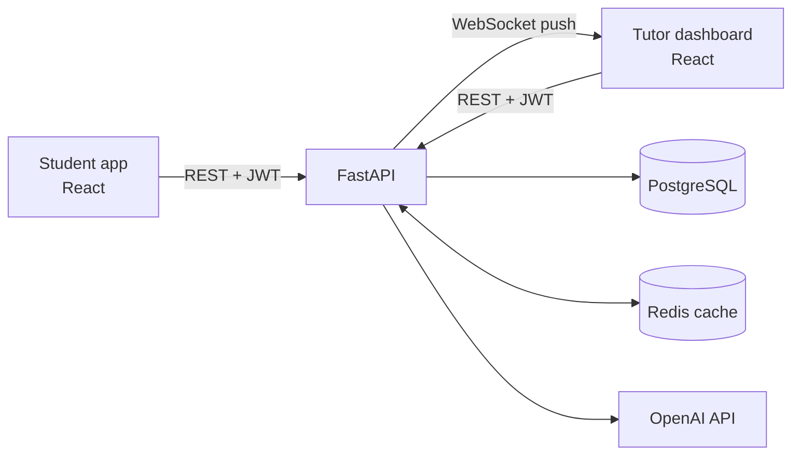

# AdaptLearn

**An AI-powered learning platform that shows students *why* they answered wrong, not just the right answer, and gives tutors a live view of where the class is struggling.**

[Live demo](https://YOUR-APP.vercel.app) · [Demo video](https://youtu.be/YOUR-VIDEO) · [API docs](https://YOUR-SERVICE.onrender.com/docs)

Demo accounts: `student@demo.com` / `demo1234` and `tutor@demo.com` / `demo1234`. The free API server sleeps when idle, so the first request can take up to a minute.


---

## Why I built this

In my first and second year at IIT (BHU), I worked as a Subject Matter Expert at Chegg India, writing step-by-step solutions for students. Then generative AI arrived, and Chegg's business model broke: Chegg sold answers, and AI made answers free. Chegg's stock fell from about $113 in February 2021 to under $1 in 2026.

As a student, I noticed two things AI didn't fix:

1. **AI answers are not always correct**, and a student can't tell when they're wrong.
2. **Getting an answer is not the same as learning.** Copying a solution doesn't tell you which concept you're missing.

So I asked: if answers are free, what is still valuable? **Knowing exactly where you're going wrong.** AdaptLearn is my attempt to build that.

## What it does

| Students | Tutors |
|---|---|
| Practise questions concept by concept | Watch a live feed of every answer |
| Get an AI hint that explains the mistake, not the answer | See a heatmap of error rate per concept |
| Track a gap score (0 = mastered, 1 = struggling) per concept | See which students are at risk, and in which concept |

## Screenshots

| Practice with a hint | Progress | Live tutor dashboard |
|---|---|---|
|  |  |  |

## Architecture



**When a student submits an answer:** the API marks it, asks OpenAI for a hint if it's wrong (with a guardrail and a fallback), saves the attempt and updates the gap score in one transaction, clears the cached dashboard stats, and pushes an event to connected tutors over WebSocket after the response is sent.

## Tech stack

| Layer | Technology | Why |
|---|---|---|
| Frontend | React, Vite, React Router | Component UI with live updates |
| Backend | FastAPI (Python) | Validation from type hints, auto docs, async + WebSockets |
| Database | PostgreSQL, SQLAlchemy 2.0 | Relational data with joins and aggregations |
| Auth | JWT (PyJWT), bcrypt | Stateless auth; passwords never stored in plain text |
| AI | OpenAI API | Explains the mistake behind a wrong answer |
| Cache | Redis | Dashboard aggregates cached with TTL and invalidation |
| Real-time | WebSockets | Server pushes answers to tutors instantly |
| Testing / CI | pytest, GitHub Actions | 20 tests on every push |
| Deployment | Docker, Render, Vercel, Neon, Upstash | Same container locally and in production |

## Key engineering decisions

- **Gap score as an exponential moving average** of mistakes per student and concept: recent answers weigh more, so improvement shows quickly, and the score always stays between 0 and 1.
- **The AI never blocks a submission.** A timeout, one retry and a fallback hint cover every failure, and a guardrail rejects hints that leak the answer.
- **Cache-aside with invalidation:** dashboard stats are cached for 30 seconds and deleted whenever a new answer arrives.
- **Role-based access control** with FastAPI dependencies: sign-up always creates a student, and tutor routes return 403 to students.
- **WebSocket auth by token**, checked before the connection is accepted; the database session is released straight away.

## Results

> Replace with your own measured numbers (see `docs/benchmarks.md`).

- Dashboard API p50 latency: **[X] ms → [Y] ms** with Redis caching (deployed, 200 requests each)
- **20** automated tests, green on every push

## Run it locally

Prerequisites: Docker Desktop, Python 3.12, Node.js 22.

```bash
git clone https://github.com/YOUR_USERNAME/AdaptLearn.git
cd AdaptLearn

# Backend + PostgreSQL + Redis
docker compose up --build
docker compose exec api python -m scripts.seed --demo   # in a second terminal

# Frontend
cd frontend
npm install
npm run dev        # http://localhost:5173
```

API docs: http://localhost:8000/docs. Tests: `cd backend && pytest -q`.

## API overview

| Method | Endpoint | Who |
|---|---|---|
| POST | `/auth/register`, `/auth/login` | Public |
| GET | `/auth/me` | Logged in |
| GET | `/questions/concepts`, `/questions/next?concept=` | Logged in |
| POST | `/questions` | Tutor |
| POST | `/attempts` | Student |
| GET | `/attempts/me`, `/analytics/me/gaps` | Student |
| GET | `/analytics/dashboard`, `/analytics/concepts`, `/analytics/at-risk` | Tutor |
| WS | `/ws/dashboard?token=` | Tutor |

## What I'd build next

- Cache AI hints per question and chosen option, so each misconception is explained once
- Redis Pub/Sub so live updates work across several API instances
- A prerequisite graph: if Integration is weak, check whether the real gap is Derivatives
- Alembic migrations and PostgreSQL in CI instead of SQLite

## Author

**[Your Name]** · B.Tech, IIT (BHU) Varanasi · Former Subject Matter Expert, Chegg India · [LinkedIn](#) · [Email](#)
